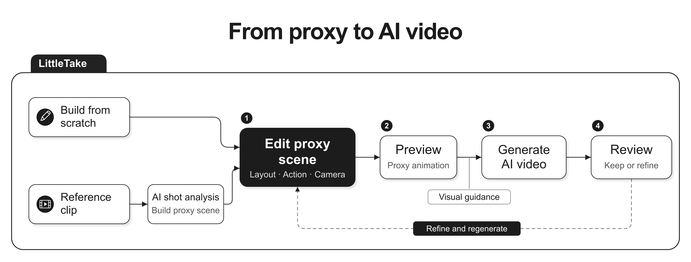

# LittleTake

> LittleTake lets anyone build and animate editable low-poly proxy scenes to guide AI models in creating videos.

A project for the **Meta Global AI Developer Hackathon**.

Live demo: [littletake.vercel.app](https://littletake.vercel.app).

Experimental WebXR: See [XR control](docs/webxr.md).

## Why

AI video models are powerful, but describing actions, camera movement, and relationships between objects through long prompts remains difficult. LittleTake lets everyday creators express those intentions through an editable 3D scene and a rough performance.

## Creator Flow



Reference clips, storyboard panels and sketches are analyzed into editable proxy scenes; drawn arrows become movement. Scenes can also be created manually. Proxy animation provides visual guidance for AI video generation.

Demo input: **The Grand Budapest Hotel — Interview with Zero**, source 0:33–0:45. The [original selected clip](public/demo/grand-budapest-zero/input.mp4), [web copy](public/demo/grand-budapest-zero/input-web.mp4) and [source metadata](public/demo/grand-budapest-zero/source.json) are included in the repository. Load the web copy with **Video or sketch → Load demo clip**.

## Features

Desktop scope: mouse/keyboard authoring, text prompts and reference clips.

**Local development:** Projects, embedded assets, conversations and generated results are saved by the local Node server. One person edits a project while others join by code to view it. Cloud deployment is deferred for this version.

### AI Understanding

| P | Module | Scope | Status |
| --- | --- | --- | --- |
| **P0** | **Muse integration** | Measured video observations, shared-set proposals and rendered reconstruction review. Visual acceptance pending. | Partial |
| **P0** | **Tool Calling & Harness** | Conversation context, native asset function calls, bounded expert tasks and atomic preview/apply. | Partial |
| **P2** | **Vision adapters** | Adaptive cut detection selects clear source frames; cached SAM measurements, face landmarks and rendered evidence guide Muse analysis. | Partial |
| **P2** | **Reference geometry** | Muse selects original frames, requests timestamps and calls SAM; default Meta API and optional local CUDA. The local editor also exposes on-demand VGGT depth/camera tools with persistent measurement reuse. Automatic layout recovery remains experimental. | Partial |
| **P2** | **SAM 3D Body service** | Optional local deployment and human pose inference endpoint. Real model/device acceptance remains pending. | Partial |

### Authoring

| P | Module | Scope | Status |
| --- | --- | --- | --- |
| **P0** | **Scene & project model** | Multiple scenes per project, camera-owned framing and motion, shots bound to one camera and a range of shared scene time. | Done |
| **P0** | **Desktop editor** | Mouse/keyboard tools for direct scene editing. | Done |
| **P0** | **AI scene editing** | Saved Muse conversations; build sets from an empty project and preview edits across scenes, objects, cameras and shots. | Done |
| **P0** | **Motion & camera authoring** | Property keyframes for transforms, camera FOV, pivot offsets and articulated parts; manual movement recording and independent camera moves. | Done |
| **P0** | **Local project workspace** | Recent projects, code sharing, one editing seat, independent conversations, SQLite autosave and portable project archives. | Done |
| **P1** | **Advanced timing authoring** | Refine timing, sequencing and synchronization across actions and cameras. | Todo |

### Generation

| P | Module | Scope | Status |
| --- | --- | --- | --- |
| **P0** | **Muse Video generation** | Combine proxy previs and creative prompts to guide final video generation; validate Muse Video reference-input and API support. | Todo |
| **P0** | **Video brief & package** | Muse Spark reads a shot's look frames, blocking and camera timing and writes an image-to-video prompt with timed beats; one click downloads brief, frames, previs WebM and a manifest for any video model. | Done |
| **P0** | **Look-frame generation** | Muse Image renders finished film stills from clean previs frames with the shot composition locked; the first approved frame anchors the look of later frames and shots. | Partial |

### Assets

| P | Module | Scope | Status |
| --- | --- | --- | --- |
| **P0** | **Proxy asset system** | Compound geometry recipes, stable asset IDs, independent instances and semantic parts. | Partial |
| **P1** | **Asset library & templates** | Persistent local library and folder tree, Hierarchy drag/create, 12 built-in assets, generated assets and reusable instances; prepared scenes remain planned. | Partial |
| **P1** | **AI asset composition** | Dedicated Muse expert composes, renders, inspects and registers missing compound proxies. | Partial |

### Rendering

| P | Module | Scope | Status |
| --- | --- | --- | --- |
| **P0** | **Three.js runtime** | Scene rendering, camera evaluation and synchronized playback. | Done |
| **P0** | **Previs rendering & export** | Clean PNG frames and current-shot WebM animation at 720p/1080p, 24/30 fps. | Done |

### Deployment

| P | Module | Scope | Status |
| --- | --- | --- | --- |
| **P0** | **Vercel deployment** | Publish an HTTPS desktop web demo with Git-based production and preview deployments. | Done |

Deferred Todo:

- [ ] Multi-account support: sign-in, per-account project management and private asset libraries.
- [ ] Durable cloud asset storage and synchronization.

## Development

On Windows, double-click `setup.bat` once, set `MODEL_API_KEY` in `.env.local`, then double-click `run.bat`. Setup preserves an existing configuration and does not prepare GPU models. Run prefers port 4176 and opens the actual URL; use `run.bat 4187` or `LITTLETAKE_PORT` for a fixed port. Browser projects belong to their URL, including its port.

```bat
setup.bat
run.bat
run.bat check
```

Local VGGT is optional and separate from the editor: `setup.bat vggt` prepares the Python 3.12/CUDA environment and cached source and weights without inference. It reuses compatible installed dependencies; otherwise it installs from the lockfile. `setup.bat sam` prepares optional local SAM; `setup.bat all` prepares both. Install [uv](https://docs.astral.sh/uv/getting-started/installation/) and Git before preparing local models. Existing prepared revisions are reused, and configuration/measurements remain intact. `run.bat check` verifies local files without loading a model. Setup pauses before closing; set `LITTLETAKE_NO_PAUSE=1` for terminal automation.

Configure `VGGT_MODEL_REPO`, `VGGT_DEVICE` and `LOCAL_MODEL_MIN_FREE_VRAM_GB` in `.env.local`. `run.bat` starts the editor and local `/api/depth` service together. After local model setup, Muse can use `estimate_reference_depth` on an attached reference frame. Startup checks files without loading PyTorch; a depth request starts the existing Python inference, then releases its GPU memory. The API shares the editor's port and stops with it. Repeated source/model requests reuse measurements from `.littletake/geometry/runs`, including after a restart. Local VGGT is unavailable on Vercel.

`run.bat geometry ...` still forwards the same [geometry CLI](server/reference/geometry/README.md) with configuration defaults; explicit CLI flags take precedence. For manual execution use `run.bat geometry depth --run path/to/measurement`.

Other platforms can use the normal npm commands:

```sh
npm install
npm run dev
```

`npm test` checks scene data, motion interpolation and undo/redo. `npm run build` produces the deployable app in `dist/`.

Vercel deploys `main` to production and creates previews for other branches and pull requests.

The studio includes six primitives, transform tools, an independent shot preview, editable property keyframes, local saves, JSON and PNG/WebM export, reference-video import and conversational Muse scene editing. The in-app **Shortcuts** panel lists navigation controls.

**Parenting:** drag an object or camera onto another Hierarchy row to make it a child; drop on the root strip to detach. Multi-selection moves the selected roots together. The Inspector's **Parent** field uses the same operation. Reparenting keeps the current world pose and existing motion; parent movement, rotation and scale then affect its children. Duplicate and delete include descendants, and Undo restores the entire edit. Parents and local animation are saved with the scene. Combinations of non-uniform scale and rotation that cannot preserve an animated pose are rejected without changing the scene. Prefab Mode supports the same drag-to-parent and drop-to-origin flow for source parts; generated modifier copies are edited through their source.

**Hierarchy visibility and placement:** Ctrl-click toggles selection; Shift-click selects a range. Row eyes and the Hide/Show toolbar support selected-object batches. **H** hides selected objects; **Alt+H** shows all. Hidden objects stay in the Hierarchy but are excluded from the viewport, shot preview, snapshots and exports. Visibility is saved with the object and supports undo. Hidden objects retain their motion and components, and are skipped by placement and surface snapping. The viewport **World/Local** control sets movement/rotation axes; **Snap** configures movement and rotation increments. **Align** matches world-space bounds to the last selected visible object, which remains fixed. Numeric batch placement and alignment move complete motion paths in one undo step.

**Shot Export:** the preview panel's **Export** button opens a frozen scene snapshot. Still image exports a PNG at the current scene time; Video exports the current shot's time range as a silent WebM at 24 or 30 fps. Both support 1920×1080 and 1280×720 and omit editor overlays. Frames are evaluated at exact scene times independently of encoding speed. Cancel discards the unfinished file; completed output can be previewed and downloaded. Export does not change the scene or playhead. Video encoding requires WebCodecs on **localhost or HTTPS**; an unsupported browser or insecure remote address shows an explanation. PNG remains available. Implementation lives in `src/shot-export/`; browser and file verification is recorded in [editor basics verification](docs/verification/editor-basics.md).

The local workspace stores multiple projects. Each project contains multiple physical scenes and multiple Muse conversations. Each conversation has separate messages and a saved draft; all conversations work on the same project. The scene and shot selectors choose the current context; each message records its scene, shot and selection. Use the conversation title to switch chats and **+** to start a new one. **Muse / Inspector** switches the right panel. Refresh restores the project, including chat history. An interrupted response is saved for an explicit retry.

**Export project** includes every scene, camera, shot, conversation and referenced asset definition. Scene exports containing assets are portable single-scene project files. **Open scene / project** restores a project, or adds a standalone scene to the current project. The scene menu also provides **Export current scene** and **New empty project** (downloads the existing project first). New scenes start empty; Muse can propose a complete set from a description. v1 scene/project files migrate automatically, including camera motion and chat receipts. Reusable assets live in the local server library; cloud sync remains planned. Clearing browser storage removes recent-project shortcuts and unsent drafts; saved projects remain in the local server and can be reopened by code. Export a project to keep a portable copy.

The saved model uses **Project → Scenes**, and each scene owns **Objects, Cameras and Shots**. **Assets / Scenes** lists the current project's scenes, with open, new and undoable delete actions; deleting a scene keeps reusable library assets. Cameras own their transform, field of view and motion; each shot references one camera and a range of scene time. **Add Shot** reuses the selected camera, then the active shot's camera, then the scene's first camera; it creates a camera only when none exists. Shots sharing a camera also share its framing and motion. Use **Duplicate shot and camera** for independent framing. Remove or reassign a camera's shots before deleting it. Actors, props and cameras use absolute scene seconds. Playback runs the whole scene and switches cameras at shot boundaries; overlapping ranges use the most recently started shot. Changing a scene's duration preserves action timing and rejects ranges that would no longer fit.

Core integration: `validateDocument` in `src/model.ts` validates/migrates a scene; `validateProjectContent` in `src/project/model.ts` validates `{name, scenes, assets?}`. `applyProjectOperations` in `src/scene-edit/operations.ts` applies a maximum of 64 explicitly scoped operations atomically to a copy. Each operation carries `sceneId`; object, camera and shot IDs are unique within that scene. Invalid references, duplicate IDs or out-of-range motion reject the whole batch. Current bounds are 24 scenes per project, 100 objects / 128 cameras / 100 shots per scene, and 1–60 seconds per scene.

Each Muse turn replays that conversation's user/assistant history with the latest project. Questions can receive text-only replies; edits appear as a preview with **Before / After**, **Discard** and **Apply changes**. Scene edits and undo invalidate older previews. Switching conversations, scenes or shots stops an in-flight response. Retry and Update preview return to the original scene and shot context. Each scene-edit API request allows up to 12 model calls shared by the director and asset expert, a stop after two consecutive tool rounds without a new successful result, and one final-plan correction. A chat turn can request one reference-frame extraction and one scene-view follow-up (at most three API requests and 36 Muse calls); its SAM tools share a separate four-attempt cap across those requests. Each expert job allows one construction attempt, one validation correction when needed, and at most three rendered review passes within the same shared call budget. A revised recipe is rendered again even when the reviewer marks that revision approved. Explicitly resuming a failed job creates a new job and preserves the failed original. Network/provider failures and failed expert jobs never restart automatically. Conversations exceeding 200 history messages or 120,000 history characters remain saved and readable, but require a new conversation to continue. Model context uses message replay with `store: false`; encrypted reasoning replay is not part of this version.

Scene editing uses JSON output with a supplied schema, followed by strict local schema validation and an atomic project preview. Each request includes the current scene/entity IDs and actual object counts. Explicit Chinese/English object totals such as “最多 10 个物体”, “剩 9 个物体”, “at most 10 objects” and “exactly 3 objects” are bound to scenes and checked against the full proposed result, including floors and people but excluding cameras/shots and internal asset parts. A compound asset instance counts as one object. Missing or failed checks receive the same single correction attempt. These are per-request constraints; implicit counts in a list of props and arbitrary natural-language constraints are not deterministic checks.

**Download diagnostics** exports this conversation's messages/application receipts and each request's original input, model request, raw output, parsed proposal, native tool calls/results and validation/provider errors, including rejected correction attempts. Inputs are saved to IndexedDB before inference; responses are saved before showing a preview. Records survive refresh on this browser and origin, independently of project localStorage. Headers and API credentials are never included. Export diagnostics separately from **Export project** to retain them outside this browser; clearing site data removes both stores.

For video analysis, copy `.env.example` to `.env.local` and set `MODEL_API_KEY` and `MUSE_MODEL`. Vite serves the same `/api/reference` handler locally that Vercel runs in production. Model credentials are server-side environment variables.

Provider adapters live in `server/ai/`; the video-analysis workflow and validated scene conversion live in `server/reference/`. The editor consumes ordinary `SceneDocument` data. Replacing the AI provider requires an adapter and a factory entry, without changing the editor.

Reference import accepts MP4/WebM clips of 1–60 seconds, up to 3 MB. The browser scans low-resolution frames locally using adaptive HSV differences, suppresses short exposure flashes, and records hard cuts plus fade-through-black intervals. Uploading a clip shows its shots and selected thumbnails before AI calls; clicking a thumbnail seeks to its exact source time. Each shot keeps a sharp representative frame. Shots with visible change add early/late evidence and distinct intermediate frames, up to 18 frames per clip. Every detected shot is represented; clips with more than 18 shots require a shorter excerpt. General dissolves are not reliably detected by this first version. Selection preserves presentation timestamps, frame indices and reasons in the project analysis checkpoint. SAM measures only selected frames that lack saved detections, with two concepts (people and faces) per atlas; empty results are cached too. Muse still reads the full video for motion between samples and must preserve the detected shot boundaries. The scanner adapts PySceneDetect's HSV/rolling-average method in TypeScript; its BSD license is included under public/licenses/. No Python service or paid inference is used for scanning. Muse identifies recurring characters and set pieces, then uses the existing scene-edit operations and asset tools to build one colored set with shared actor paths and shot cameras. Observation, scene construction and review use high reasoning. Before a native plan is accepted, render_scene inspects the exact operations across every shot using shared meshes, evaluated poses and depth-tested visible bounds. The director finalizes with scenePreviewId and operations=[]; the application retrieves that exact inspected candidate rather than trusting a retyped plan. Its CPU lighting is approximate; the final WebGL video review remains required. render_asset can inspect a particular instance/time, preserving its current joint curves before applying trial angles. Each construction/repair request shares the scene editor's 12-call budget with asset experts. Approved assets survive a budget stop; the client permits one continuation without regenerating them. A run permits up to four rendered reviews. Network/provider failures are retained without automatic retries.

Every revision is rendered against the same original pixels before approval. Paired stills verify framing; an 8 fps video covers the complete rendered timeline and camera cuts. Both original and rendered videos reach the independent reviewer. Source observations receive an independent identity and occlusion audit, including action-relevant supporting people. YuNet facial landmarks run locally in the browser at source resolution (up to 1280 pixels), constrain clear nose/eye direction and retain uncertain or missing measurements. The model and CPU WASM runtime load only during reference processing. Measured pixels and cut times remain fixed; the expert can correct mistaken identities, facing and framing while retaining those measurements. A depth-tested object-ID pass measures the actual visible body bounds, including clipping and occlusion. Geometry-only projections remain available for diagnosis. Numeric checks describe framing and potential occluders; the expert evaluates composition, motion, layout and color. Approval requires complete motion evidence and all quality scores of at least 8. A failed draft is retained for diagnostics and cannot replace the project. Reconstruction quality is still under verification. Canonical person prefabs provide 18 joint axes for head, torso, shoulders, limbs and wrists through the shared property-keyframe system. Loading their older 11-axis form preserves mesh geometry, old poses and animation while adding the missing axes at zero. `set_property_keys` replaces one complete scalar channel; static movable-part poses use `set_asset_joint`. An asset expert can create a clothing or prop variant from a previously read `baseAssetId`, preserving its joints and template. The director can replace an existing instance with a read/generated prefab using `set_asset`, retaining its ID, placement, root/joint keys, components and tint. Incompatible joint channels reject the whole edit. These capabilities do not establish reconstruction quality.

### Local project workspace

Use Node.js 24 or newer and run `npm run dev`. **Projects** opens recent projects, creates a blank or starter project, imports a save, or joins a project code. A previous browser save is migrated once and its original data is retained. Project names can be edited in the header. Recent projects belong to the current browser; another browser joins using the code or link in **Share**. No account is required.

`server/projects/` stores project documents, rendered results and cumulative reference-call budgets in `.littletake/projects.sqlite`. Used asset definitions, all scenes, cameras, shots, property animation and conversations belong to the project document. Look directions, style references, anchor frames, look images, video briefs and reference-analysis checkpoints survive reopening. **Results** opens saved generated work and interrupted analyses. Completed analysis steps are retained; continuing always requires an explicit action. Closing the page cancels its active analysis and rendering.
One editor holds a 90-second lease, renewed every 20 seconds. Other participants view saved changes. Closing normally releases the seat; each page has its own identifier so a delayed old-page request cannot release or save over a reloaded page. Version checks reject stale documents. Browser IndexedDB retains unsent drafts and outputs during a connection failure. Retrying a create or save uses the original request identity. Saving is checked before switching projects; conflicts can be downloaded or preserved as a new project.

**Export project** downloads a `.littletake.zip` containing the document and all saved outputs. **Import project** restores that archive as a separate project. Older scene/project JSON files remain supported. Project documents are limited to 20 MB, each output to 64 MB, and an archive to 250 MB. Import validation and writes are atomic. Corrupt archives cannot replace an existing project. The SQLite online backup API includes committed WAL data.

Set `LITTLETAKE_DATA_DIR` to move the local data directory; the reusable library defaults to its `assets/` subdirectory. `LITTLETAKE_ASSET_DIR` may override the library location. Production use of these local services requires a persistent Node server. The static Vercel frontend alone does not provide this database.

Private-network HTTP links support editing, project codes, persistence and project archives. Video encoding and reference-video reconstruction need a browser secure context: use `localhost` or HTTPS. Set `LITTLETAKE_ALLOWED_HOSTS` when a development proxy uses a custom hostname.

Verification: `node --import tsx --test server/projects/rooms.test.ts src/project/storage.test.ts src/project/model.test.ts` covers migration, conversations, competing editors, late-page requests, retries, generated outputs, archive import/copy, restart, paid-call ceilings and backup restoration.

### Look frames

**Look** in the shot preview header renders the current frame, or the shot's start, middle and end, as finished film stills with Muse Image (`muse-image-1.0`, `POST /v1/images/edits`). The clean previs frame is always `@Image1`, so camera, framing and blocking come from the scene. Each request also lists the visible objects with their screen side and depth in that camera, so the model can map each proxy to what it stands for. With **Keep the look consistent** on, the first finished frame of a scene is sent as an approved reference for every later frame and shot and persists with the project; an optional saved style image only guides palette and style. Each frame is one Muse Image call. `server/look/` builds the prompt and request; `/api/look` reuses `MODEL_API_KEY` and accepts `MUSE_IMAGE_MODEL`. Request bodies stay under Vercel's 4.5 MB limit by sending 1280×720 JPEG frames and downscaled references.

### Video brief and package

The editor currently exports a hand-off for image-to-video generation. In **Look**, **Write video brief** sends up to three frames of the shot (look frames when rendered, otherwise previs) with its camera poses, field of view and each framed subject's screen side, depth and in-shot motion to Muse Spark (`/api/brief`). It returns one prompt paragraph, a camera line, timed beats and things to avoid. **Download package** saves a ZIP with `brief.md`, `manifest.json`, every look and previs still and `previs.webm` (when the browser can encode WebM). Direct video generation is not integrated.

### Asset library and modeling expert

The local reusable library uses stable prefab IDs and atomic file writes. Project documents embed the definitions they use; independent instances keep their placement, components and root/joint animation. The asset workshop and bounded expert share the same recipe and rendering implementation as the scene.

Each scene's optional `look` stores background, ground, ambient/key light and exposure. Open its card in **Assets / Scenes** to edit these in Inspector; Muse uses `set_scene_look`. Preview and exports share the same lighting. The local quality harness runs with `npx tsx src/reference/harness/server.ts` at port 4181. It preserves source frames, original proposals, calibrated renders, per-shot top views, per-round feedback and request diagnostics under `output/verification/reference-quality/`, with a persisted hard call ceiling. It can resume a saved run, compare raw/calibrated proposals without inference and play the original and reconstructed scene together.

CPU asset previews use per-pixel depth testing. Generation reviews include rest and articulated trial poses, and revision tools can render explicit joint angles. See the [complete real-Muse acceptance flow and portable project](docs/verification/asset-toolkit.md).

### Reference-frame geometry and spatial tools

Reference-frame segmentation uses `SAM_PROVIDER=cloud` by default. A prepared local CUDA installation can select `local` through `/api/segmentation` or the geometry CLI; [setup and benchmark instructions](server/reference/geometry/README.md) live with the module. The existing reference-video tracking and look-frame flows remain available.

Muse conversations accept an original image or clip through **+ Reference**. Loading a clip in **Video or sketch** shares it with the active conversation as well. The browser selects up to six candidates using cuts, sharpness and temporal coverage, retaining decoded timestamps. Muse inspects the contact sheet, reads chosen originals with `read_reference_frame`, and calls `segment_reference` for a short noun concept. It can use `request_reference_frame` to ask for up to two additional timestamps before continuing. These are original reference pixels, separate from rendered scene views.

Original reference media and segmentation observations are saved with their conversation in the project, with a project-scoped IndexedDB cache. Previous browser-only references are copied into the active project without deleting the originals. The portable project archive includes this media and supports later timestamp requests after import on another browser. Legacy JSON exports do not include media; request diagnostics contain the frames used for that request. Each user turn allows at most four new SAM attempts across frame and scene-view follow-ups, including failures. Matching cached observations are reused; provider failures are not automatically retried. SAM returns 2D masks and composition measurements; it does not establish depth or metric layout.

Agent safeguards apply to one task, not a cumulative development quota: the director stops after two consecutive tool rounds with no new successful observation, with twelve shared Muse calls per backend request. Completed observations and ready assets survive a stop; scene edits remain a reviewable proposal. Development verification records calls and errors without a lifetime call ceiling.

[Spatial operations](src/spatial/README.md) provide measured support placement, relative edge gaps, facing, alignment, distribution, anchors and paths through scene edits, Muse tools and `POST /api/spatial`. They share viewport geometry and the editor's whole-animation transform logic, preserving property key times, interpolation and takes.
### Optional background worker (paused)

The separate worker in `server/reference/jobs/` is retained from the advanced work. It is not used by the editor's foreground workflow and is not started by `npm run dev`. It has not been deployed. `npm run jobs` and `npm run verify:jobs` remain available for its isolated implementation and fixture verification; its optional URL, key and data directory are listed in `.env.example`.
