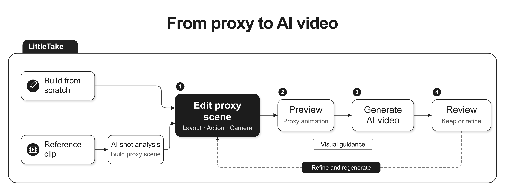

# LittleTake

> LittleTake lets anyone build and animate editable low-poly proxy scenes to guide AI models in creating videos.

A project for the **Meta Global AI Developer Hackathon**.

Live demo: [littletake.vercel.app](https://littletake.vercel.app).

Experimental WebXR: See [XR control](docs/webxr.md).

## Why

AI video models are powerful, but describing actions, camera movement, and relationships between objects through long prompts remains difficult. LittleTake lets everyday creators express those intentions through an editable 3D scene and a rough performance.

## Creator Flow



Reference clips are analyzed into editable proxy scenes; scenes can also be created manually. Proxy animation provides visual guidance for AI video generation.

Demo input: **The Grand Budapest Hotel — Interview with Zero**, source 0:33–0:45. The [original selected clip](public/demo/grand-budapest-zero/input.mp4), [web copy](public/demo/grand-budapest-zero/input-web.mp4) and [source metadata](public/demo/grand-budapest-zero/source.json) are included in the repository. Load the web copy with **Reference video → Load demo clip**.

## Features

Desktop scope: mouse/keyboard authoring, text prompts and reference clips.

**Current scope, before November 2026:** Generated and edited assets use local storage. The cloud demo assumes a single shared user. Durable cloud asset storage and account separation are deferred.

### AI Understanding

| P | Module | Scope | Status |
| --- | --- | --- | --- |
| **P0** | **Muse integration** | Video input, scene understanding and structured scene proposals. | Done |
| **P0** | **Tool Calling & Harness** | Conversation context, native asset function calls, bounded expert tasks and atomic preview/apply. | Partial |
| **P2** | **Vision adapters** | SAM 3.1 tracks people in reference clips alongside Muse analysis; tracks ground draft placement and motion timing and appear over the review video. | Partial |
| **P2** | **SAM 3D Body service** | Separate model deployment and inference for human 3D pose estimation from reference frames. | Todo |

### Authoring

| P | Module | Scope | Status |
| --- | --- | --- | --- |
| **P0** | **Scene & project model** | Multiple scenes per project, camera-owned framing and motion, shots bound to one camera and a range of shared scene time. | Done |
| **P0** | **Desktop editor** | Mouse/keyboard tools for direct scene editing. | Done |
| **P0** | **AI scene editing** | Saved Muse conversations; build sets from an empty project and preview edits across scenes, objects, cameras and shots. | Done |
| **P0** | **Motion & camera authoring** | Basic object/character motion and independent camera moves. | Done |
| **P1** | **Advanced timing authoring** | Refine timing, sequencing and synchronization across actions and cameras. | Todo |

### Generation

| P | Module | Scope | Status |
| --- | --- | --- | --- |
| **P0** | **Muse Video generation** | Combine proxy previs and creative prompts to guide final video generation; validate Muse Video reference-input and API support. | Todo |
| **P0** | **Video brief & package** | Muse Spark reads a shot's look frames, blocking and camera timing and writes an image-to-video prompt with timed beats; one click downloads brief, frames, previs WebM and a manifest for any video model. | Done |
| **P0** | **Look-frame generation** | Muse Image renders finished film stills from clean previs frames with the shot composition locked; the first approved frame anchors the look of later frames and shots. | Partial |

### Assets

| P | Module | Scope | Status |
| --- | --- | --- | --- |
| **P0** | **Proxy asset system** | Compound geometry recipes, stable asset IDs, independent instances and semantic parts. | Partial |
| **P1** | **Asset library & templates** | Persistent local library and folder tree, Hierarchy drag/create, 12 built-in assets, generated assets and reusable instances; prepared scenes remain planned. | Partial |
| **P1** | **AI asset composition** | Dedicated Muse expert composes, renders, inspects and registers missing compound proxies. | Partial |

### Rendering

| P | Module | Scope | Status |
| --- | --- | --- | --- |
| **P0** | **Three.js runtime** | Scene rendering, camera evaluation and synchronized playback. | Done |
| **P0** | **Previs rendering & export** | Clean PNG frames and current-shot WebM animation at 720p/1080p, 24/30 fps. | Done |

### Deployment

| P | Module | Scope | Status |
| --- | --- | --- | --- |
| **P0** | **Vercel deployment** | Publish an HTTPS desktop web demo with Git-based production and preview deployments. | Done |

Deferred Todo:

- [ ] Multi-account support: sign-in, per-account project management and private asset libraries.
- [ ] Durable cloud asset storage and synchronization.

## Development

```sh
npm install
npm run dev
```

`npm test` checks scene data, motion interpolation and undo/redo. `npm run build` produces the deployable app in `dist/`.

Vercel deploys `main` to production and creates previews for other branches and pull requests.

The studio includes six primitives, transform tools, an independent shot preview, start/end motion tracks, local saves, JSON and PNG/WebM export, reference-video import and conversational Muse scene editing. The in-app **Shortcuts** panel lists navigation controls.

**Hierarchy visibility and placement:** Ctrl-click toggles selection; Shift-click selects a range. Row eyes and the Hide/Show toolbar support selected-object batches. **H** hides selected objects; **Alt+H** shows all. Hidden objects stay in the Hierarchy but are excluded from the viewport, shot preview, snapshots and exports. Visibility is saved with the object and supports undo. Hidden objects retain their motion and components, and are skipped by placement and surface snapping. The viewport **World/Local** control sets movement/rotation axes; **Snap** configures movement and rotation increments. **Align** matches world-space bounds to the last selected visible object, which remains fixed. Numeric batch placement and alignment move complete motion paths in one undo step.

**Shot Export:** the preview panel's **Export** button opens a frozen scene snapshot. Still image exports a PNG at the current scene time; Video exports the current shot's time range as a silent WebM at 24 or 30 fps. Both support 1920×1080 and 1280×720 and omit editor overlays. Frames are evaluated at exact scene times independently of encoding speed. Cancel discards the unfinished file; completed output can be previewed and downloaded. Export does not change the scene or playhead. Video encoding requires WebCodecs on **localhost or HTTPS**; an unsupported browser or insecure remote address shows an explanation. PNG remains available. Implementation lives in `src/shot-export/`; browser and file verification is recorded in [editor basics verification](docs/verification/editor-basics.md).

Storage keeps one active project in this browser, containing multiple physical scenes and multiple Muse conversations. Each conversation has separate messages and a saved draft; all conversations work on the same project. The scene and shot selectors choose the current context; each message records its scene, shot and selection. Use the conversation title to switch chats and **+** to start a new one. **Muse / Inspector** switches the right panel. Refresh restores the project, including chat history. An interrupted response is saved for an explicit retry.

**Export project** includes every scene, camera, shot, conversation and referenced asset definition. Scene exports containing assets are portable single-scene project files. **Open scene / project** restores a project, or adds a standalone scene to the current project. The scene menu also provides **Export current scene** and **New empty project** (downloads the existing project first). New scenes start empty; Muse can propose a complete set from a description. v1 scene/project files migrate automatically, including camera motion and chat receipts. Reusable assets live in the local server library; cloud sync remains planned. Clearing browser storage removes local history; export a project to keep a portable copy.

The saved model uses **Project → Scenes**, and each scene owns **Objects, Cameras and Shots**. Cameras own their transform, field of view and motion; each shot references one camera and a range of scene time. **Add Shot** reuses the selected camera, then the active shot's camera, then the scene's first camera; it creates a camera only when none exists. Shots sharing a camera also share its framing and motion. Use **Duplicate shot and camera** for independent framing. Remove or reassign a camera's shots before deleting it. Actors, props and cameras use absolute scene seconds. Shot ranges may overlap, and playback previews the selected shot's range. Changing a scene's duration preserves action timing and rejects ranges that would no longer fit.

Core integration: `validateDocument` in `src/model.ts` validates/migrates a scene; `validateProjectContent` in `src/project/model.ts` validates `{name, scenes, assets?}`. `applyProjectOperations` in `src/scene-edit/operations.ts` applies a maximum of 64 explicitly scoped operations atomically to a copy. Each operation carries `sceneId`; object, camera and shot IDs are unique within that scene. Invalid references, duplicate IDs or out-of-range motion reject the whole batch. Current bounds are 24 scenes per project, 100 objects / 128 cameras / 100 shots per scene, and 1–60 seconds per scene.

Each Muse turn replays that conversation's user/assistant history with the latest project. Questions can receive text-only replies; edits appear as a preview with **Before / After**, **Discard** and **Apply changes**. Scene edits and undo invalidate older previews. Switching conversations, scenes or shots stops an in-flight response. Retry and Update preview return to the original scene and shot context. Each scene-edit API request allows up to 12 model calls shared by the director and asset expert, at most 8 director tool rounds, and one final-plan correction. A chat turn can make one additional API request for scene views (at most 24 calls across both requests). Each expert job allows at most 4 calls: construction, an optional validation correction, rendered inspection and an optional revision inspection. Network/provider failures and failed expert jobs never restart automatically. Conversations exceeding 200 history messages or 120,000 history characters remain saved and readable, but require a new conversation to continue. Model context uses message replay with `store: false`; encrypted reasoning replay is not part of this version.

Scene editing uses JSON output with a supplied schema, followed by strict local schema validation and an atomic project preview. Each request includes the current scene/entity IDs and actual object counts. Explicit Chinese/English object totals such as “最多 10 个物体”, “剩 9 个物体”, “at most 10 objects” and “exactly 3 objects” are bound to scenes and checked against the full proposed result, including floors and people but excluding cameras/shots and internal asset parts. A compound asset instance counts as one object. Missing or failed checks receive the same single correction attempt. These are per-request constraints; implicit counts in a list of props and arbitrary natural-language constraints are not deterministic checks.

**Download diagnostics** exports this conversation's messages/application receipts and each request's original input, model request, raw output, parsed proposal, native tool calls/results and validation/provider errors, including rejected correction attempts. Inputs are saved to IndexedDB before inference; responses are saved before showing a preview. Records survive refresh on this browser and origin, independently of project localStorage. Headers and API credentials are never included. Export diagnostics separately from **Export project** to retain them outside this browser; clearing site data removes both stores.

For video analysis, copy `.env.example` to `.env.local` and set `MODEL_API_KEY` and `MUSE_MODEL`. Vite serves the same `/api/reference` handler locally that Vercel runs in production. Model credentials are server-side environment variables.

Provider adapters live in `server/ai/`; the video-analysis workflow and validated scene conversion live in `server/reference/`. The editor consumes ordinary `SceneDocument` data. Replacing the AI provider requires an adapter and a factory entry, without changing the editor.

Reference import currently accepts MP4/WebM clips of 1–60 seconds, up to 3 MB. It builds a coarse single-shot draft with separate objects, basic motion and a camera bound to the shot. Review it before adding it as a new scene; Undo removes that addition. Geometry, depth and motion are AI estimates, with simplifications shown in the review.

**SAM 3.1 grounding.** While Muse Spark reads the clip, `/api/reference` sends the same clip to SAM 3.1 (`sam-3.1`, Responses API, streamed) with the noun phrase `person`, so tracking adds no waiting time. Each tracked person is paired with the draft person nearest to it on screen. When their feet are visible, foot points are cast through the draft camera onto the y=0 floor: a static person is placed at the median foot point, and a person who walks gets a start/end pose and start/stop times from the tracked path, even if Muse kept them static. Without visible feet and with a fixed camera, an existing Muse move is only retimed. The review player draws the tracked boxes, and the draft notes list what tracking changed. MP4 frame counts come from the `stsz` box so SAM frame indices map to seconds. Placement still depends on Muse's camera estimate; seated or cropped subjects keep Muse positions. SAM failures never block a draft. `SAM_TRACKING=off` disables the extra call.

### Look frames

**Look** in the shot preview header renders the current frame, or the shot's start, middle and end, as finished film stills with Muse Image (`muse-image-1.0`, `POST /v1/images/edits`). The clean previs frame is always `@Image1`, so camera, framing and blocking come from the scene. Each request also lists the visible objects with their screen side and depth in that camera, so the model can map each proxy to what it stands for. With **Keep the look consistent** on, the first finished frame of a scene is sent as an approved reference for every later frame and shot while the page is open; an optional style image only guides palette and style. Each frame is one Muse Image call. `server/look/` builds the prompt and request; `/api/look` reuses `MODEL_API_KEY` and accepts `MUSE_IMAGE_MODEL`. Request bodies stay under Vercel's 4.5 MB limit by sending 1280×720 JPEG frames and downscaled references.

### Video brief and package

Meta Model API does not serve a video model yet, so generation ends in a hand-off any image-to-video model can take. In **Look**, **Write video brief** sends up to three frames of the shot (look frames when rendered, otherwise previs) with its camera poses, field of view and each framed subject's screen side, depth and in-shot motion to Muse Spark (`/api/brief`). It returns one prompt paragraph, a camera line, timed beats and things to avoid. **Download package** saves a ZIP with `brief.md`, `manifest.json`, every look and previs still and `previs.webm` (when the browser can encode WebM). Muse Video can replace this hand-off once it is available.

### Asset library and modeling expert

`src/assets/` owns editable asset recipes, geometry, bounds, the library panel and the independent asset workshop. `server/assets/` owns persistence, the dedicated expert, its rendered inspections and the director tools: `search_assets`, `read_asset`, `generate_asset`, `get_asset_job`, `instantiate_asset`. The director searches and inspects reusable assets first. Only a missing asset is delegated to the expert. The generation expert sees its own brief and geometry, renders front/side/isometric views using the same Three.js primitives as the stage, and must approve the inspected recipe before registration. Program checks prove data consistency and report measurements; they do not prove that a model looks correct.

The local library persists ready definitions and complete expert job histories under `.littletake/assets/`, or `LITTLETAKE_ASSET_DIR`, excluded from Git. Vercel uses the runtime's temporary directory by default because its application filesystem is read-only ([runtime documentation](https://vercel.com/docs/functions/runtimes)); that cache is temporary and is not shared reliably between function instances. No durable cloud library is configured. Instances reference a stable asset ID and own their transform, tint, components and motion. Each prefab has one current definition in `definitions/<assetId>.json`. Projects embed used definitions for portability. Opening a project, refreshing its library, or returning focus to the editor reconciles those definitions with the current local library; embedded definitions remain available when the library is unavailable or has no matching asset. Old versioned files migrate to the latest definition with originals retained in `legacy-backup/`. Locally, registered assets remain reusable after discarding a scene preview or undoing an instance. Expert failures retain their input, raw replies and errors but do not register an asset or alter the scene.

### Asset editing mode

Drag a **Hierarchy** object into a **My Assets** folder, or right-click it and choose **Create Independent Prefab…**. The Inspector exposes the same creation flow. Choose a name and folder (a drop preselects its destination); folders can also be created inside the dialog. Creation publishes geometry, components and relative motion, then links only the source object to the new asset. Its position, rotation, scale, motion and components remain unchanged. Its tint is baked into the new asset once, preserving its appearance. Other instances retain their original references. Undo restores the scene link without deleting the library asset.

**My Assets** is shared by every project using this local server. Its directory tree supports nested/empty folders, renaming a folder, and dragging existing assets between folders. `catalog.json` stores logical folder paths and asset ID locations separately from `definitions/`; moves and renames do not modify model definitions or invalidate references. Generated and edited assets without a location appear at the root. Folder and asset saves survive a server restart. Unsaved workshop drafts remain browser-local until **Save Prefab** publishes them. Library organization stays on the server; project exports embed used models rather than the whole library and its folders.

Open **Edit Prefab** on an instance or library card. Asset mode stays inside the existing studio shell: the left Hierarchy shows asset parts, the right Inspector edits the selection, and the center viewport isolates the asset. Header, sidebar widths, timeline and status bar keep their positions. A viewport breadcrumb returns to the scene with its previous selection and camera view; the scene timeline is inactive while editing the asset. This isolated draft is not a project scene. It provides add/duplicate/remove, parent assignment, numeric transforms, move/rotate/size handles, colors and joint limits/pivots. Bounds and front/side/isometric geometry renders update with the draft. Joint sliders and controller previews reset without recording motion. Part sizes scale only their mesh; children inherit position/rotation, not mesh dimensions. Joint axes and pivots are expressed inside the already-rotated part's local frame. Edits preserve the asset origin.

The **Muse** tab has its own saved conversation. A revision request replays the last 16 messages alongside the authoritative draft. Its four native tools are `read_asset_draft`, `edit_asset`, `measure_asset` and `render_asset`; `edit_asset` uses the same atomic reducer as manual edits. Measurements include actual joint/cylinder axes, and rendering can trial joint angles. The expert must inspect the latest edited revision before reporting approval. Each request is bounded to 8 model calls with no automatic provider retry. Results are staged for **Use This Draft / Discard Proposal**, never auto-published. Failed jobs retain the intermediate draft and raw requests, tool results and errors; **Inspect unfinished draft** explicitly identifies a draft that has not received final expert evaluation.

**Save Prefab** updates the original asset and all linked instances. It replaces only the shared model definition: existing instance transforms, tint, motion and component settings stay intact. New instances receive the current template defaults. **Create Independent Prefab…** in Prefab Mode uses the shared name/folder dialog to create a separate ID for a different shape; existing scene references stay attached to the original. Scene undo does not revert a saved prefab. Conflicting stale saves return 409 and retain the local draft; identical retries are safe. Drafts, proposals and asset conversations persist per asset ID in browser storage; **Export Draft** downloads that state separately from the project. Project export contains saved definitions, not unsaved workshop drafts or server job history.

The studio interface uses English system labels. User-authored names and conversation messages keep their original text. Scene and prefab Inspectors share one searchable **Add Component** menu. **Pivot Offset** is a passive local XYZ modifier that can coexist with **Movement Controller**. Changing, disabling, or removing the pivot leaves geometry poses and existing motion untouched. Rotate/scale handles, numeric transform edits, keyboard control, and prefab control previews use the same pivot compensation. Recording stores the resulting geometry poses, so editing a pivot later does not rewrite the take. Multiple selections still use their shared selection center. Legacy rotation controllers remain readable for existing projects but are not offered in the component menu.

The workshop uses `components/model.ts` and `performance/motion.ts` for `asset.template`. Component defaults can be edited and tested here. Both manual placement and director asset tools retain component defaults and recorded motion when creating independent scene instances. Saving a scene instance as an asset also preserves its construction parameters and modifiers.

The asset [construction toolkit](src/assets/toolkit/README.md) adds reusable groups, ordered Mirror/Array modifiers, parameter expressions and anchor connections inside the existing prefab Inspector. Both Muse specialists use the same evaluator as the stage and measurements. Saved recipes retain source relationships; generated copies can be detached individually or baked together.

CPU asset previews use per-pixel depth testing. Generation reviews include rest and articulated trial poses, and revision tools can render explicit joint angles. See the [complete real-Muse acceptance flow and portable project](docs/verification/asset-toolkit.md).
