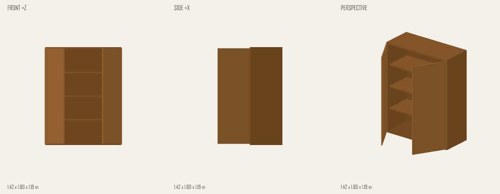

# 资产 toolkit 整合验收 · 2026-10-27

使用真实 `muse-spark-1.3-contributor`，从空项目完成生成、编辑、保存 v2、跨对话复用和导出重开。共 15 次模型请求，统一硬上限 16 次；58 项测试和生产构建通过。

可在 LittleTake 的 **Open scene / project** 打开 [验收项目](asset-toolkit.project.json)。它包含地面、两个独立柜子实例、相机、镜头、两条场景对话，以及引用的完整资产定义，不依赖本机资产库。

| 步骤 | 核对结果 |
| --- | --- |
| 从零生成 | `search_assets → generate_asset → instantiate_asset`；专家生成双开门柜并入库；场景恰好 2 个物体 |
| 手动编辑 | 在原编辑器布局内打开资产，宽度由 1.2 改为 1.4 米 |
| 专家编辑 | `edit_asset → render_asset → render_asset`；深度改为 0.6 米，检查关门和双门 -60° 的图像 |
| 保存 | 发布不可变 v2，只更新当前实例；实例位置、颜色和动作保持不变 |
| 新对话复用 | `search_assets → read_asset → instantiate_asset`；第二个实例位于 `[2.2, 0, 0]`，复用相同 ID/v2，无生成调用 |
| 重开 | 浏览器刷新、项目文件导入再导出；完整项目与对话数据一致，相机和镜头未改变 |

最终柜子尺寸为 **1.4 × 1.8 × 0.6 米**。9 个源节点通过两个 Mirror 和一个 Array 展开为 17 个节点、10 个几何部件，保留 3 块等距层板和两扇独立铰链门。资产原点与参数关系随版本一起保存。

CPU 预览使用每像素深度测试；回归流程确认闭合门板和柜体遮挡内部几何，打开镜像门后内部可见。生成专家同时检查静止和关节试动视图；程序提供尺寸与图像证据，造型评价由专家完成。

原始模型输入、输出、工具结果和任务记录保留在本地诊断和资产任务中；项目样例包含场景对话，资产专家对话另随草稿保存。生成任务 `8db96dd0-708a-4931-bd07-1a33262b1959`，v2 编辑任务 `0f07e98b-c3af-4505-b8bb-b228f812accf`。

这次是本地完整流程验收。Vercel 资产缓存仍是临时存储；项目嵌入的定义可随文件保存，持久云端资产库尚未接入。

## 本地资产重启与跨项目复用 · 2026-10-27

在浏览器中从上述真实 Muse 柜子保存「本地复用柜（含动作）」v1，再在资产编辑器将宽度从 1.4 米改为 1.6 米并保存 v2。两个版本都进入共享本地库；「我的资产」同时显示原始生成版、原始编辑版和手动保存的版本。

停止并重新启动验证服务后，新建空项目 B，直接从资产库放入 v2，再复制和单独移动第二个实例。核对导出文件确认：原项目 A 重启及切换前后的内容完全一致；项目 B 的两个实例共用一份 v2 定义，保留参数化结构、移动组件和 5 秒移动 2 米的动作；修改第二个实例未改变第一个，刷新后项目 B 的完整内容一致。

9 项相关测试和生产构建通过。本轮使用已有真实 Muse 资产，新增模型调用为 0。截图、项目导出、重启前后进程与资产数据，以及自动核对结果保留在本机 `output/verification/asset-persistence/`。
